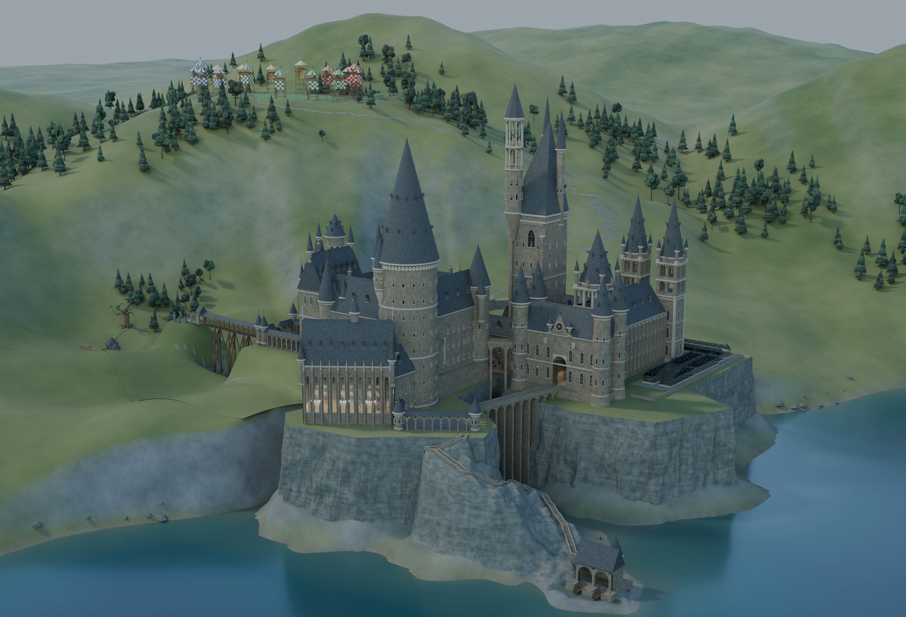
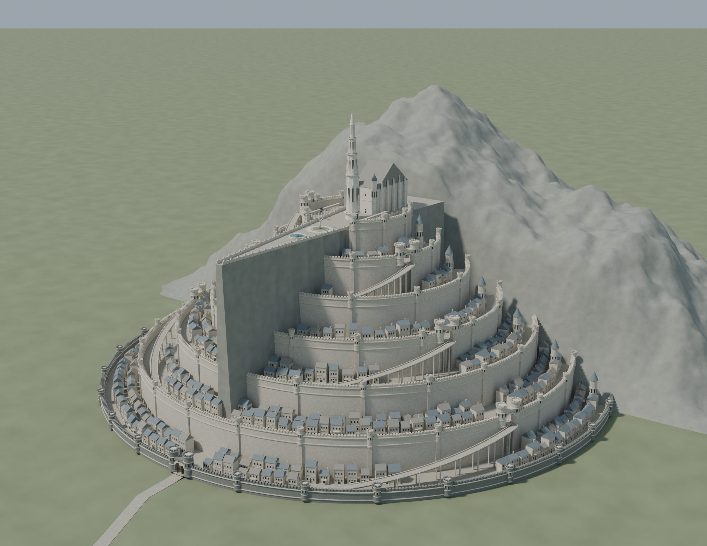

<div align="center">

# Cad Worlds

**Fictional worlds, imagined in three dimensions.**

A collection of editable Blender projects exploring the architecture and landscapes of places from fantasy.

[Explore Hogwarts](#hogwarts) · [Explore Middle-earth](#middle-earth) · [Open the models](#opening-the-models)

</div>

---

## Hogwarts

[](Hogwarts/)

The first world in the collection brings together the castle, its interiors, the Black Lake and the surrounding grounds. Explore the halls and staircases inside, or follow the landscape beyond the castle walls.

- **Model:** [Hogwarts-esterni-perfezionati.blend](Hogwarts/outputs/Hogwarts-esterni-perfezionati.blend)
- **Explore:** [exterior guide](Hogwarts/outputs/Hogwarts-esterni-GUIDA.txt) · [interior guide](Hogwarts/outputs/Hogwarts-interni-GUIDA.txt) (in Italian)
- **More views:** [Great Hall](Hogwarts/outputs/Hogwarts-interni-Sala-Grande.png) · [grand staircase](Hogwarts/outputs/Hogwarts-interni-Scalinata.png) · [grounds](Hogwarts/outputs/Hogwarts-esterni-tenuta.png)

The [outputs](Hogwarts/outputs/) folder also contains earlier versions, images and resources; [work](Hogwarts/work/) contains scripts and working materials. The model is an interpretation rather than an official architectural plan.

## Middle-earth

[](Middle-earth/Minas-Tirith/)

The journey into Middle-earth begins with **Minas Tirith**: seven circles rising around the great stone prow, city districts, and a citadel crowned by the White Tree.

This first version is an exterior interpretation. Further architectural detail and connections between the city's levels remain to be developed.

- **Model:** [Minas-Tirith.blend](Middle-earth/Minas-Tirith/outputs/Minas-Tirith.blend)
- **Project details:** [Minas Tirith README](Middle-earth/Minas-Tirith/README.md)
- **More views:** [main gate](Middle-earth/Minas-Tirith/outputs/Minas-Tirith-gate.png) · [citadel](Middle-earth/Minas-Tirith/outputs/Minas-Tirith-citadel.png) · [plan](Middle-earth/Minas-Tirith/outputs/Minas-Tirith-plan.png)

## Opening the models

The `.blend` files are managed with [Git LFS](https://git-lfs.com/). After installing Git LFS, run the following commands in your local copy of the repository to retrieve the models:

```sh
git lfs install
git lfs pull
```

Open the desired `.blend` file in [Blender](https://www.blender.org/). Each project's guides describe how to explore it and explain its limitations.

---

These are unofficial fan interpretations. The fictional worlds and associated names belong to their respective rights holders.
